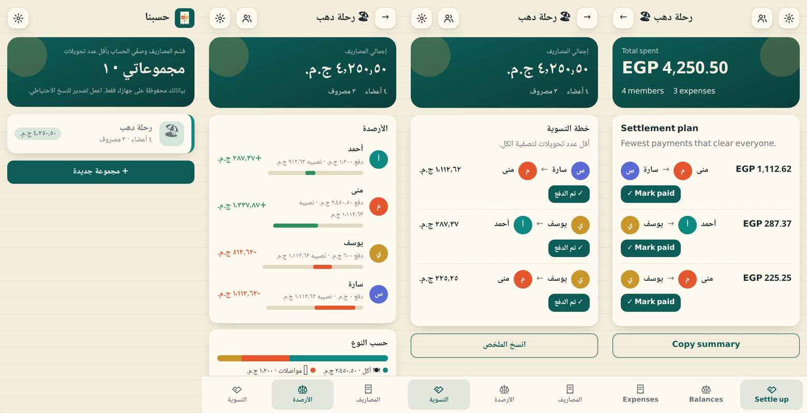
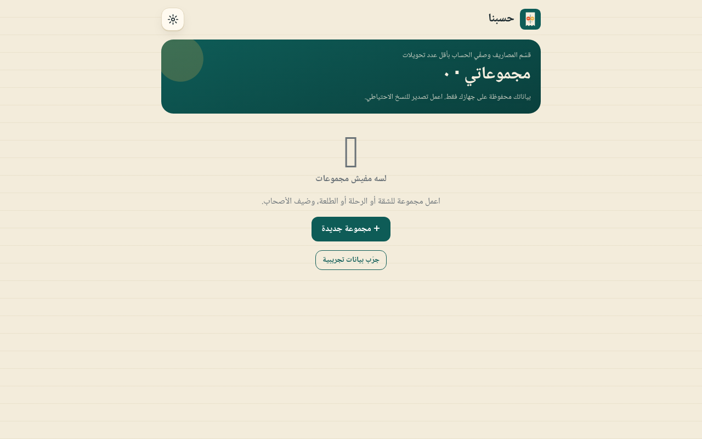
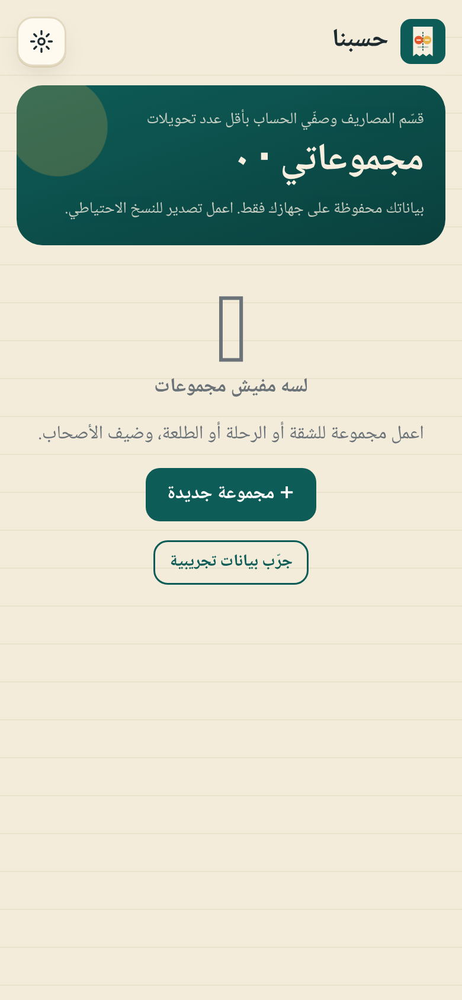

<p align="center"></p>

<h1 align="center">7sebna · حسبنا</h1>
<p align="center"><b>Split expenses with flatmates, trips and outings. Settle up with the fewest payments.</b><br>
قسّم المصاريف مع زمايلك في الشقة أو الرحلة أو الخروجة، وصفّي الحساب بأقل عدد تحويلات.</p>
<p align="center"><a href="https://yousefkhames.github.io/7sebna/"><b>Live app → yousefkhames.github.io/7sebna</b></a></p>



## Screenshots

Captured from the live site (https://yousefkhames.github.io/7sebna/).

<p>
  
  
</p>

## What it does

Make a group (a flat, a trip, a night out), add the people, log who paid what, and 7sebna works out who owes whom. The settlement plan uses at most *n − 1* payments for *n* people. Tap "Mark paid" when someone transfers the money and the balances update.

No sign-up, no server, no tracking. Everything stays in your browser.

## Features

- Groups with an icon, a currency (EGP, SAR, AED, KWD, USD, EUR, GBP, JOD, QAR) and any number of members
- Four ways to split an expense: equally, by shares, by percent, or by exact amounts, with live "sum / left" feedback and validation
- Paid-by, date and category per expense; edit or delete any expense
- Balances per person (paid vs. their share) and a spending-by-category bar
- Settlement plan with the fewest transfers, "Mark paid" with undo, and a copy-to-clipboard summary you can paste into WhatsApp
- Arabic (default, full RTL) and English, light and dark theme
- Export all data as JSON, import it back (validated and sanitised), export a group as CSV (opens in Excel with Arabic text)
- Works offline after the first visit (service worker) and can be added to the home screen

## Money handling

Amounts are stored as integer piasters/cents, never floats. Uneven splits (100.00 ÷ 3) use largest-remainder rounding so shares always add up to the exact total, and balances always sum to zero. This is covered by unit tests, including a randomised test of 300 groups.

## Tech

Plain HTML, CSS and JavaScript. No framework, no build step, no dependencies at runtime. State lives in `localStorage`.

- `core.js` money math, splits, balances, settlement, import sanitising (no DOM, unit tested)
- `app.js` UI and Arabic / English strings
- `style.css` design
- `sw.js`, `manifest.webmanifest` offline and install support

## Run and test

```bash
python3 -m http.server 8123        # then open http://localhost:8123
node --test tests/core.test.js     # unit tests, no dependencies
npm i puppeteer-core && PPT=puppeteer-core node tests/e2e.js   # browser click-through (needs Chrome at /usr/bin/google-chrome)
```

## Honest limits

- Data is per browser and per device. There is no sync and no shared group: each person would see only their own copy. Use the JSON export or the copied summary to share.
- Clearing site data erases your groups. Export a backup if it matters.
- Settlement is the true minimum number of payments for groups of up to 15 people with an open balance (exact search for the most separate zero-sum clusters, then matching inside each). Beyond 15 people it falls back to a greedy match, which still clears every balance in at most n − 1 payments.
- One currency per group, no exchange rates.
- It records payments; it does not move money.
- Arabic text was reviewed by the author only, not by a professional translator.

## License

MIT © Yousef Khames
